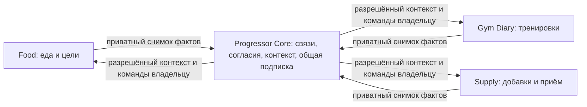

# Техническая и интерфейсная прогонка — 16 октября 2026

Программа охватывает Food, Gym Diary, Supply и их общие связи. Основание: [технический стандарт](TECHNICAL_QUALITY_STANDARD.md), [система удобства](USER_EXPERIENCE_STANDARD.md), [исследование](QUALITY_RESEARCH.md). Контракты следующего разработчика — в [QUALITY_PROGRAM.md](QUALITY_PROGRAM.md). Документ описывает проверенный состав изменения; фактические версии развёртывания и приватные копии записываются в эксплуатационном журнале.

## Что улучшено

- Core читает согласованные небольшие проекции для контекста, настроек и подписок. Тренерские связи не подменяют статус личной подписки. Исторические запросы используют свой день; подробные записи сохраняются у владельца.
- Приватная SQLite 3.54.0 устанавливается отдельно от системной библиотеки. Новые окружения содержат явно закреплённые зависимости; старые окружения остаются для отката.
- Проверены границы владельца, права тренера, отзыв разрешений, пользовательский текст, повторные платежи, устаревшие команды, лимиты ИИ и сохранение истории. Повторный опрос Supply использует устойчивое состояние попытки; чтение результата не создаёт запрос ИИ.
- Свой экран запускается с собственной проверкой Telegram, даже если Core недоступен. Между приложениями переносится исходная подтверждённая сессия. Секреты и утверждения доступа не отправляются на сторонние адреса.
- Общие подписки показывают текущий доступ. Основные сроки — 1, 6 и 12 месяцев; рубли и Stars стоят рядом в одинаковых кнопках. Старые дополнительные сроки доступны через «Другие сроки». Суммы оплаты и зачёт дней по-прежнему подтверждаются сервером.
- Исправлены фокус, закрытие и возврат вложенных экранов, узкие экраны, увеличенный текст, контраст и состояния загрузки/ошибки. Выбор настроек сохраняется при сбое; конфликт другого окна требует явного обновления.

## Где хранится код

Серверная реализация Core находится только в `MarkKoro/progressor_core`. В Gym нет второй копии этого backend. Каждый бот сохраняет свою базу и предметные операции. Небольшие общие клиенты и начальный скрипт запуска распространяются из `Core/shared` в три репозитория; проверка при обновлении требует их побайтного совпадения. Полный общий интерфейс загружается из Core. Следующий агент меняет канонический файл и синхронизирует его зеркала, сохраняя один источник реализации.

## Проверки

Изолированный Linux: **640 тестов**, без ошибок и пропусков — Core 246, Gym 221, Food 111, Supply 62. Внешние соединения запрещены, провайдеры фиктивные, дополнительных потребителей Telegram нет. Архив проверенного исходника: SHA256 `64fb05bc6a04702414ecb32067fa460bcd03c69d08f1b41777f7e40bbd5fddfd`; последующие изменения перед публикацией ограничены документацией.

Реальные HTML/API с синтетическим Telegram SDK: **153 сценария в 13 группах**. Ширины 320–1280 CSS px, увеличенный текст, две темы, все восемь сочетаний платного доступа, переходы обратно, недоступность Core, ошибки и конфликты настроек, естественное истечение Food без удаления истории. Для 322 видимых текстовых фрагментов на 18 экранах измеренный контраст прошёл проверку; неопределённых измерений нет.

На большом синтетическом дневнике при пяти параллельных клиентах и 100 измерениях p95:

| Компонент | Чтение | Сохранение |
|---|---:|---:|
| Gym | 96 мс | 192 мс |
| Food | 26 мс | 143 мс |
| Supply | 128 мс | 207 мс |
| Core: контекст | 903 мс | 131 мс |

Настройки Core — 78 мс, подписки — 15 мс. Размер большой истории: 1004 тренировки, 20 060 подходов, 4122 приёма пищи, 10 000 отметок добавок. Подтверждённые конкурентные записи не потеряны; целостность баз проверена. Это задержки приложения на стенде, без внешней сети, Telegram и ИИ.

Физические клиенты Telegram, настоящие платежи, новая платная оценка точности фото и пользовательские полевые метрики в эту проверку не входят. Нутриенты и расход энергии остаются оценками; неполный дневник не доказывает клинический дефицит. Дата дневника Food — Europe/Moscow; время напоминаний настраивается отдельно.

## Обновление

Обычная команда на сервере — `update-all`. Она получает `main` всех четырёх репозиториев, готовит зависимости, проверяет кандидатов, создаёт ограниченную копию, переключает службы и проверяет запуск. При ошибке возвращает предыдущий код и окружения, сохраняя новые пользовательские записи. Повтор без изменений не перезапускает службы.

Первое обновление этого выпуска запускается проверенным новым updater из подготовленной копии: прежняя установленная версия ещё не умеет устанавливать приватную SQLite. После успешной проверки новый updater становится обычным обработчиком `update-all`. Подробные версии, копии, контроль места и результаты рабочего сервера сохраняются в приватном журнале эксплуатации.
